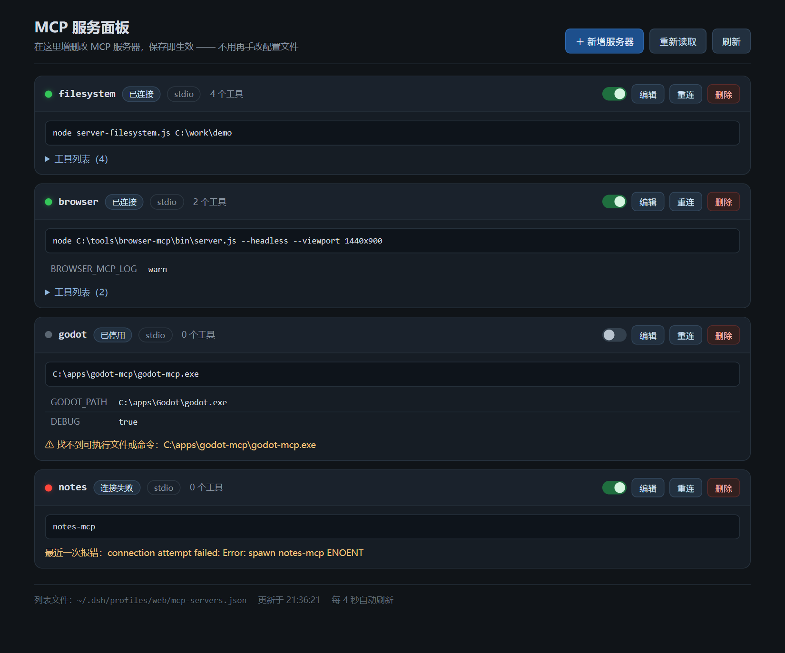
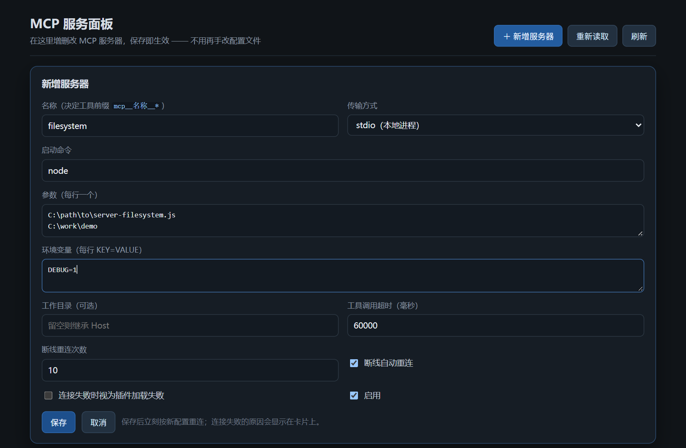

<div align="center">


# MCP Live Panel

**MCP servers for DeepSeek Harness, managed from the browser.**
Add, edit, enable, restart, remove — applied live, no config edits, no restart.

[](https://github.com/greendoyle/dsh-mcp-live-panel/actions/workflows/ci.yml)
[](https://www.npmjs.com/package/dsh-mcp-live-panel)
[](https://www.npmjs.com/package/dsh-mcp-live-panel)
[](LICENSE)

<sub>DSH 0.2.0.x · Node 22.19+ / 24.9+ · MIT</sub>

[English](README.md) · [简体中文](README.zh-CN.md)

</div>



## Why

DSH's MCP support (`@deepseek-ai/dsh-mcp-client`) is one `insert` row per server in `cordis.patch.yml`. That works — until it doesn't:

- ❌ **A typo is invisible.** Point `command` at a path that does not exist and the client retries with backoff: the console fills with `spawn ... ENOENT` while the GUI shows nothing at all.
- ❌ **Every change is a restart.** Disable one server, change one env var, and you are back in YAML.
- ❌ **The schema is easy to forget.** `transport`, `args`, `env`, `cwd`, `headers`, `reconnect`…

This plugin turns that list into cards you can click. Underneath it is still the official `dsh-mcp-client`, so tool names (`mcp__<server>__<tool>`), behaviour and performance are unchanged.

## Features

| Feature | What it does |
| --- | --- |
| **Live CRUD** | Add, edit, rename, enable, disable, restart, delete. The Loader creates, updates or disposes exactly the affected `mcp-client` entries while the Host keeps running. |
| **Real diagnostics** | Every save checks the command — bare names against `PATH` + `PATHEXT`, paths against the file itself — so a typo shows up instead of retrying silently. Failures show the underlying cause from the Host log, attributed per server. |
| **Nothing to hand-edit** | The list lives in `<profile>/mcp-servers.json`, mounted by a `cordis:include` row this bundle declares itself. Installing it is the only configuration step. |
| **Survives config reloads** | The list is a nested Loader tree, so editing your profile's `cordis.patch.yml` (DSH hot reload) never drops servers added from the panel. |
| **Zero runtime dependencies** | The host half uses `node:fs` / `node:http` only. The page is three static files read per request, so UI edits need no Host restart. |
| **Bilingual entry** | The Settings entry follows your language (en / zh). |

## Quick start

```bash
# DSH's plugin manager shells out to pnpm
npm i -g pnpm

# install the bundle into your web profile
dsh plugin --profile web add dsh-mcp-live-panel
```

Or, in the GUI: **Plugins → Add plugin → `dsh-mcp-live-panel` → Install → Enable now**.

Then open **Settings → MCP panel**, or go straight to <http://127.0.0.1:3080/mcp>.

> The first launch creates an empty `mcp-servers.json`. Nothing is spawned until you add a server.

## The panel



| Action | Where | Effect |
| --- | --- | --- |
| **Add** | ＋ New server | Saves, then connects; tools register as `mcp__<name>__<tool>` |
| **Edit / rename** | *Edit* on a card | Restarts that server with the new configuration |
| **Enable / disable** | The switch | Disabling disconnects the process, unregisters its tools and stops the retries |
| **Reconnect** | *Reconnect* | Dispose + connect again, keeping the configuration |
| **Remove** | *Delete* | Disconnects and drops the row |
| **Re-read** | *Reload* | Re-applies the file after you edit it by hand |

Two transports are supported, with the form adapting to the choice:

- **stdio** — command, arguments (one per line), environment variables (`KEY=VALUE`), working directory;
- **streamable-http** — URL and request headers (`Key: Value`).

Plus tool-call timeout, reconnect attempts, and an enabled flag. "Fail plugin activation on connection failure" exists for advanced use — leave it off.

## How it works

```text
<profile>/cordis.patch.yml            ← you never touch this
├── mcp-servers   (cordis:include)    ← mounts the managed list
└── mcp-panel                         ← this package: page + JSON API

<profile>/mcp-servers.json            ← owned by the panel
└── { id, name: '@deepseek-ai/dsh-mcp-client', config, disabled? }
```

1. A panel write validates the row, atomically rewrites `mcp-servers.json`, then refreshes the include subtree.
2. The Loader diffs that subtree: new rows connect, changed rows restart, removed rows disconnect and unregister their tools.
3. Because the list is a **subtree** of the include, DSH's profile-config hot reload leaves it alone.

The browser half is one Settings section embedding the host page; its label is registered in both languages.

## Configuration

The bundle patch ships sensible defaults. Override by entry id when you need to:

```yaml
- id: mcp-panel
  config:
    path: '/mcp'              # page + API mount
    includeId: 'mcp-servers'  # the include row that mounts the list
    store: 'mcp-servers.json' # relative to the profile, or absolute
```

If `/mcp` is already taken by another plugin, change `path` (and `PANEL_PATH` in `lib/client.js`, or navigate to the new path directly) — otherwise that row fails to load with a duplicate-route error.

## Requirements

- DSH **0.2.0.x** — enforced twice: `engines.dsh` and `peerDependencies`. DSH refuses an incompatible install instead of crashing after it.
- Node **22.19+** or **24.9+**.
- `pnpm` on `PATH` for `dsh plugin` and the Plugins page.

## Upgrade, remove, migrate

<details>
<summary>Click for the maintenance details</summary>

- **Upgrade**: plugins do not update themselves. Run `dsh plugin --profile web add dsh-mcp-live-panel@latest`; your server list is untouched.
- **Remove**: drop the bundle in the Plugins page, or run `dsh plugin --profile web remove dsh-mcp-live-panel`. `mcp-servers.json` stays in the profile and comes back if you reinstall.
- **Migrating from hand-written rows**: delete the old `dsh-mcp-client` entries from your `cordis.patch.yml` first, then install and rebuild them in the panel. Two owners of the same `serverName` — or of `/mcp` — conflict.

</details>

## Security

- The host half runs **in-process with your user permissions**: it spawns the commands you configure and writes `<profile>/mcp-servers.json`. Only add servers you trust.
- The page and its API are served by DSH's own Web server (loopback by default) with no extra authentication. Do not expose it.
- Environment variables are stored in plain text in that JSON file. Keep long-lived secrets out of it.

## Development

```bash
npm test            # 55 host assertions + 21 browser-half assertions
npm pack --dry-run  # inspect the published contents
```

`test/panel-test.mjs` drives the real plugin through a fake Cordis context — page, state, CRUD, validation, log attribution. `test/client-test.mjs` drives the browser half through a fake module loader, slots and locale service.

```text
lib/index.js        host half: store, JSON API, assets, log attribution
lib/client.js       browser half: the Settings section
assets/             page HTML/CSS/JS, read from disk per request
locale/             plugin card title/description (en, zh-CN)
cordis.patch.yml    bundle layer: mcp-servers + mcp-panel rows
test/               both suites, no running Host required
```

<details>
<summary>Releasing (maintainers)</summary>

`.github/workflows/ci.yml` runs both suites on Node 22 and 24 for every push and pull request.

`.github/workflows/publish.yml` publishes from a `v*` tag with `--provenance`, after checking that the tag matches `package.json` and that the version is not on npm yet. A manual run is a dry run unless you unset `dry_run`.

One-time setup: create an npm token (granular with **Read and write**, or a classic **Automation** token) and save it as the repository secret `NPM_TOKEN`.

```bash
npm version patch          # bump + tag vX.Y.Z
git push --follow-tags     # CI publishes
```

`--provenance` needs a **public** repository (GitHub OIDC). On a private one, drop the flag.

</details>

## License

MIT © [GreenDoyle](https://github.com/greendoyle)

---

<sub>Not affiliated with DeepSeek. Built for [DeepSeek Harness](https://github.com/deepseek-ai/deepseek-harness).</sub>
