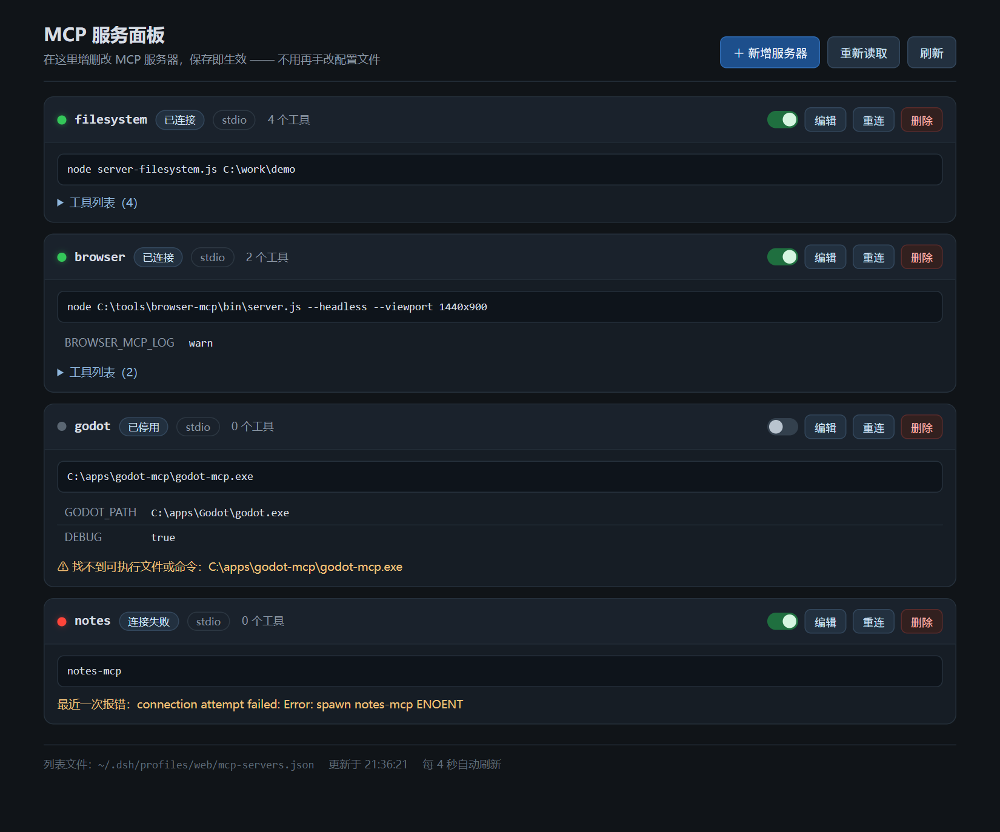
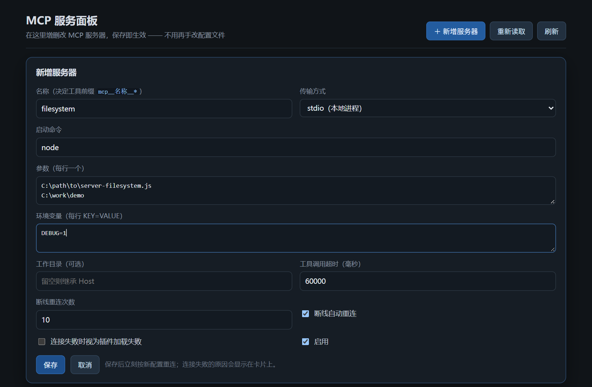

<div align="center">


# MCP 实时面板

**在浏览器里管理 DeepSeek Harness 的 MCP 服务器。**
增、删、改、启停、重连 —— 保存即生效，不改配置文件，不重启。

[](https://github.com/greendoyle/dsh-mcp-live-panel/actions/workflows/ci.yml)
[](https://www.npmjs.com/package/dsh-mcp-live-panel)
[](https://www.npmjs.com/package/dsh-mcp-live-panel)
[](LICENSE)

<sub>DSH 0.2.0.x · Node 22.19+ / 24.9+ · MIT</sub>

[English](README.md) · **简体中文**

</div>



## 为什么需要它

DSH 的 MCP 支持（`@deepseek-ai/dsh-mcp-client`）是 `cordis.patch.yml` 里每个服务器一行 `insert`。能用，但很别扭：

- ❌ **写错了看不出来。** 命令指向一个不存在的路径，客户端就按退避策略一直重试：控制台刷满 `spawn ... ENOENT`，界面上却什么都没有。
- ❌ **每次改动都要重启。** 停一个服务器、改一个环境变量，又得回到 YAML。
- ❌ **字段记不住。** `transport`、`args`、`env`、`cwd`、`headers`、`reconnect`……

这个插件把那份列表变成可以点的卡片。底层仍然是官方的 `dsh-mcp-client`，所以工具名（`mcp__<服务器>__<工具>`）、行为和性能都没有改变。

## 特性

| 特性 | 说明 |
| --- | --- |
| **实时增删改** | 新增、编辑、改名、启停、重连、删除。Loader 只创建 / 更新 / 释放受影响的那几个 `mcp-client` 条目，Host 全程不重启。 |
| **真的会报错** | 每次保存都校验命令：裸命令查 `PATH` + `PATHEXT`，路径查文件本身，写错当场标出来而不是悄悄重试。连接失败时从 Host 日志里按服务器归因，显示真正的原因。 |
| **不用手改配置** | 列表存在 `<profile>/mcp-servers.json`，由本 bundle 自己声明的 `cordis:include` 行挂载。装好即用，没有第二步。 |
| **不怕配置热重载** | 列表是 include 的**子树**，所以你改 profile 的 `cordis.patch.yml`（DSH 配置热重载）不会把面板里加的服务器冲掉。 |
| **零运行时依赖** | 宿主半边只用 `node:fs` / `node:http`；页面是三个静态文件，每次请求读盘，改界面不用重启 Host。 |
| **双语入口** | 设置页里的入口跟随语言（en / zh）。 |

## 快速开始

```bash
# DSH 的插件管理底层用 pnpm
npm i -g pnpm

# 把 bundle 装进 web profile
dsh plugin --profile web add dsh-mcp-live-panel
```

或者在界面里：**Plugins → 添加插件 → `dsh-mcp-live-panel` → 安装 → 立即启用**。

然后打开 **设置 → MCP 面板**，或直接访问 <http://127.0.0.1:3080/mcp>。

> 首次启动会建一个空的 `mcp-servers.json`；在你添加服务器之前，不会 spawn 任何进程。

## 面板



| 操作 | 位置 | 效果 |
| --- | --- | --- |
| **新增** | ＋ 新增服务器 | 保存后立即连接，工具以 `mcp__<名称>__<工具>` 注册 |
| **编辑 / 改名** | 卡片上的「编辑」 | 按新配置重启该服务器 |
| **启用 / 停用** | 卡片右侧开关 | 停用会断开进程、注销工具，并停止重试 |
| **重连** | 卡片上的「重连」 | 只重连，不动配置 |
| **删除** | 卡片上的「删除」 | 断开并从列表移除 |
| **重新读取** | 顶部「重新读取」 | 手改文件后按文件内容重载 |

支持两种传输，表单会随选择变化：

- **stdio** —— 启动命令、参数（每行一个）、环境变量（`KEY=VALUE` 每行）、工作目录；
- **streamable-http** —— URL 与请求头（`Key: Value` 每行）。

另有工具调用超时、断线重连次数和启用开关；「连接失败时视为插件加载失败」是给特殊场景的，一般别开。

## 工作原理

```text
<profile>/cordis.patch.yml            ← 你不需要碰
├── mcp-servers   (cordis:include)    ← 挂载被管理的列表
└── mcp-panel                         ← 本插件：页面 + JSON API

<profile>/mcp-servers.json            ← 面板独占写入
└── { id, name: '@deepseek-ai/dsh-mcp-client', config, disabled? }
```

1. 面板的每次写入都会先校验，再原子地重写 `mcp-servers.json`，然后刷新 include 子树。
2. Loader 对子树做 diff：新增的连上、改动的重启、删掉的断开并注销工具。
3. 因为列表是 include 的**子树**，DSH 的 profile 配置热重载不会动它。

浏览器半边只是设置页里的一个分节，内嵌宿主渲染的页面；它的标题同时注册了中英文。

## 配置

bundle patch 已给好默认值。需要时按条目 id 覆盖：

```yaml
- id: mcp-panel
  config:
    path: '/mcp'              # 页面与 API 的挂载路径
    includeId: 'mcp-servers'  # 挂载列表的那一行
    store: 'mcp-servers.json' # 相对 profile 目录，或绝对路径
```

如果 `/mcp` 已经被别的插件占用，请改 `path`（同时改 `lib/client.js` 里的 `PANEL_PATH`，或直接访问新路径），否则这一行会因路由重复而加载失败。

## 环境要求

- DSH **0.2.0.x** —— 双重门禁：`engines.dsh` 与 `peerDependencies`。版本不匹配时 DSH 会直接拒绝安装，而不是装完再崩。
- Node **22.19+** 或 **24.9+**。
- `pnpm` 在 `PATH` 里（`dsh plugin` 和 Plugins 页需要）。

## 升级、卸载、迁移

<details>
<summary>点开看维护细节</summary>

- **升级**：插件不会自动更新。执行 `dsh plugin --profile web add dsh-mcp-live-panel@latest`，服务器列表不受影响。
- **卸载**：在 Plugins 页移除该 bundle，或 `dsh plugin --profile web remove dsh-mcp-live-panel`。`mcp-servers.json` 会留在 profile 里，重装即可恢复。
- **从手写配置迁移**：先把 `cordis.patch.yml` 里旧的 `dsh-mcp-client` 行删掉，再安装、在面板里重建。同一个 `serverName`（或 `/mcp` 路由）被两处占用会冲突。

</details>

## 安全说明

- 宿主半边运行在 Host 进程内，**拥有你的用户权限**：它会 spawn 你配置的命令、写 `<profile>/mcp-servers.json`。只添加你信任的 MCP 服务器。
- 页面与 API 由 DSH 自己的 Web 服务器提供（默认只监听回环），没有额外鉴权；不要把它暴露到公网。
- 环境变量以明文存在那个 JSON 文件里，别放长期凭证。

## 开发

```bash
npm test            # 宿主 55 项 + 浏览器半边 21 项断言
npm pack --dry-run  # 检查发布内容
```

`test/panel-test.mjs` 用假的 Cordis 上下文驱动真实插件代码（页面、状态、增删改、校验、日志归因）；`test/client-test.mjs` 用假的模块加载器、slots 与 locale 驱动浏览器半边。

```text
lib/index.js        宿主半边：store、JSON API、资源、日志归因
lib/client.js       浏览器半边：设置页里的分节
assets/             页面 HTML/CSS/JS（每次请求读盘）
locale/             插件卡片标题/描述（en、zh-CN）
cordis.patch.yml    bundle 层：mcp-servers + mcp-panel 两行
test/               两套测试，不依赖运行中的 Host
```

<details>
<summary>发布（维护者）</summary>

`.github/workflows/ci.yml`：每次 push / PR 在 Node 22 与 24 上跑两套测试。

`.github/workflows/publish.yml`：推 `v*` tag 时发布（带 `--provenance`），发布前会校验 tag 与 `package.json` 版本一致、且该版本还没在 npm 上；手动运行默认只做 dry run。

一次性配置：在 npm 建 token（granular 勾 **Read and write**，或 classic 选 **Automation**），存成仓库 secret `NPM_TOKEN`。

```bash
npm version patch          # 改版本并打 vX.Y.Z tag
git push --follow-tags     # CI 自动发布
```

`--provenance` 需要**公开仓库**（GitHub OIDC）；私有仓库把它去掉。

</details>

## 许可证

MIT © [GreenDoyle](https://github.com/greendoyle)

---

<sub>与 DeepSeek 官方无关，为 [DeepSeek Harness](https://github.com/deepseek-ai/deepseek-harness) 而写。</sub>
